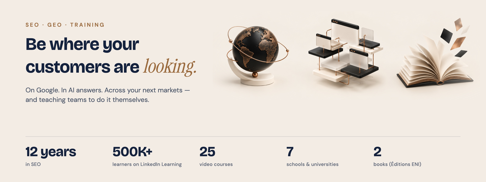
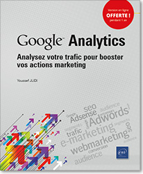
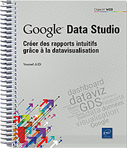

  

<h1 align="center">Youssef Jlidi</h1>

  <b>SEO &amp; GEO consultant · Trainer · Author</b>

  
  
  

  

 

## About

I have spent 12 years in SEO, in-house and as a consultant, and today I work on two fronts: getting brands found on Google and getting them cited in AI-generated answers. I currently work with Club Med on SEO strategy for France and coordination across EMEA markets.

The other half of my work is teaching. I have recorded 25 video courses for LinkedIn Learning, written two books, and I have taught in seven business schools and universities since 2017. I use AI the way I want my learners to use it: as a working tool, with a human checking every output.

 

## What I do

| Focus | In one line |
|:--|:--|
| 🔎 **SEO** | Get found: technical SEO, keyword and page planning, multi-market reporting. |
| 🤖 **GEO / AI search** | Get cited: measure and improve how a brand shows up in ChatGPT, Gemini, Perplexity and Google AI Overviews. |
| 🌍 **International** | Scale across markets: one method, adapted market by market. |
| 🧩 **AI agents** | Automate the repetitive work, with a human approving every step that matters. |
| 🎓 **Training** | Understand → practise → apply: courses and workshops for marketing and SEO teams, from fundamentals to applied AI. |

 

## Teaching &amp; publications

<table>
  <tr>
    <td width="33%" valign="top">
      <h3>🎬 LinkedIn Learning</h3>
      <b>25 courses</b> · <b>500,000+ learners</b> 
      Video courses on SEO, data and AI, in French, since 2017.
    </td>
    <td width="33%" valign="top">
      <h3>📚 Éditions ENI</h3>
      
 

      <b>2 books</b> in the <i>Objectif Web</i> collection: Google Analytics (2020) and Google Data Studio (2022).
    </td>
    <td width="33%" valign="top">
      <h3>🏛️ Schools &amp; universities</h3>
      <b>7 institutions</b> since 2017: Paris School of Business, SKEMA, Paris Digital School, SUP de Web, Université Paris 12, Université d'Évry, IUT de Sceaux.
    </td>
  </tr>
</table>

<b>Where I teach</b>

| School | What I teach |
|:--|:--|
| Paris School of Business | M2 Digital Business: *SEO Search Engine* and *Discoverability & Organic Growth* |
| SKEMA Business School | Advanced SEO, SERP analysis, coaching on organic acquisition projects; thesis supervisor on AI topics |
| Paris Digital School | Digital marketing productivity, content optimisation, performance dashboards |
| SUP de Web | Semantic clustering, topic clusters, internal linking for e-commerce |
| Université Paris 12 | Digital marketing, web analytics, Google Analytics, SEO fundamentals |
| Université d'Évry · IUT de Sceaux | Guest lecturer |

<b>Selected LinkedIn Learning courses</b> (in French)

 

| Course | Topic | Published |
|:--|:--|:--:|
| [Les fondements du référencement](https://www.linkedin.com/learning/les-fondements-du-referencement-24845963) | SEO fundamentals | 2025 |
| [Découvrir les outils du référencement](https://www.linkedin.com/learning/decouvrir-les-outils-du-referencement-19248172) | SEO tools | 2023 |
| [Le référencement : La recherche de mots-clés](https://www.linkedin.com/learning/le-referencement-la-recherche-de-mots-cles-22664806) | Keyword research | 2023 |
| [Le référencement : Les audits](https://www.linkedin.com/learning/le-referencement-les-audits-21872793) | SEO audits | 2023 |
| [Les fondements du SEO international](https://www.linkedin.com/learning/les-fondements-du-seo-international-19089103) | International SEO | 2023 |
| [L'essentiel de Google Analytics 4 (GA4)](https://www.linkedin.com/learning/l-essentiel-de-google-analytics-4-ga4) | Analytics | 2022 |
| [Construire une stratégie de link building](https://www.linkedin.com/learning/construire-une-strategie-de-link-building) | Link building | 2020 |

<b>Books</b> (Éditions ENI, in French)

 

| Title | Year | ISBN |
|:--|:--:|:--|
| *Google Analytics : Analysez votre trafic pour booster vos actions marketing* | 2020 | 978-2-409-02665-2 |
| *Google Data Studio : Créer des rapports intuitifs grâce à la datavisualisation* | 2022 | 978-2-409-03354-4 |

Author page: [editions-eni.fr/youssef-jlidi](https://www.editions-eni.fr/youssef-jlidi)

 

## Open-source projects

Small tools from my day-to-day work, published so others can reuse them.

| Project | What it does | Stack |
|:--|:--|:--|
| [**seo-cluster**](https://github.com/YoussefJlidi/seo-cluster) | Turn a Semrush/Ahrefs keyword export into a page plan. | Python · pandas · scikit-learn |
| [**deck-claim-checker**](https://github.com/YoussefJlidi/deck-claim-checker) | Check every number and claim in a slide deck before it reaches a client. | Python · python-pptx |

 

## Open-source contributions

**In progress.** First pull requests are being prepared.

> Contributions are prepared with an AI agent team and always reviewed by me before submission.

 

## Tech stack

  
  
  
  
  
  
  
  

  
  
  
  
  

 

---

  <a href="https://youssef-jlidi.com">youssef-jlidi.com</a> · <a href="https://www.linkedin.com/in/youssefjlidi/">LinkedIn</a>
    
  Search is changing fast. I'd rather learn it in the open, and teach what holds up.

